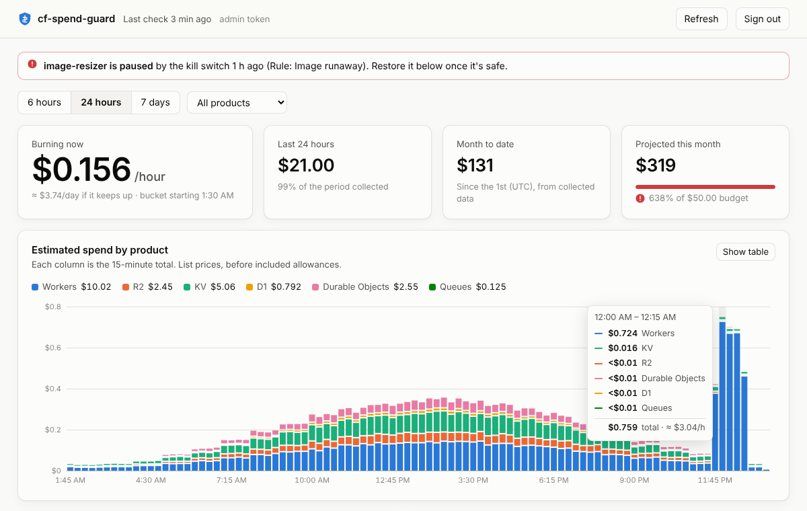
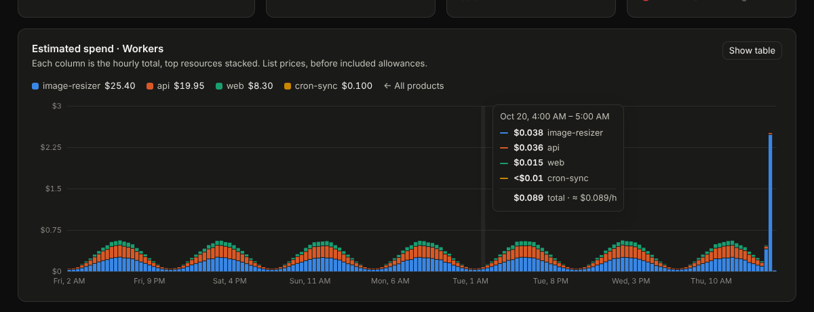

# cf-spend-guard

**Find out within minutes, not on your invoice, when something in your Cloudflare account starts burning money. Optionally, have it shut off before the bill gets big.**

Cloudflare's paid plans have no hard spending cap. The built-in budget alerts are useful but fire roughly a day after a threshold is crossed. A recursive Worker, a bot hammering an endpoint, or a Durable Object that never hibernates can cost thousands of dollars before then.

cf-spend-guard is a small Worker you deploy into your own account. Every 5 minutes it:

1. **Collects usage** from the Cloudflare GraphQL Analytics API: Workers, R2, KV, D1, Durable Objects and Queues, per script, bucket, namespace, database and queue.
2. **Estimates cost** from list prices and turns it into a burn rate ($/hour).
3. **Checks your rules.** Example: "alert if the account burns more than $2/hour" or "pause the `api` Worker if it burns more than $20/hour for 10 minutes".
4. **Detects anomalies**: usage that is far outside the last 7 days' normal for that resource, *and* expensive enough to matter.
5. **Projects the month** against your budget.
6. **Alerts** you on Slack, Discord, PagerDuty or any webhook. If you turned on the kill switch, it also **pauses the offending Worker**: routes, workers.dev and custom domains are detached and crons stopped. One API call restores everything.

It also serves a **dashboard** showing your burn rate, spend over time by product and resource, alerts, kill-switch controls and health checks.

It runs on your account, uses your own API token, and sends your data nowhere except the alert channels you set up.



[](https://deploy.workers.cloudflare.com/?url=https://github.com/timoconnellaus/cf-spend-guard)

> **Cost of the guard itself:** one scheduled Worker invocation and a handful of small D1 queries every 5 minutes (~8,600 runs/month). That fits comfortably inside the Workers Paid plan's included usage.

---

## Quick start

### Option A: Deploy to Cloudflare button

1. Click **Deploy to Cloudflare** above. Cloudflare forks this repo into your GitHub or GitLab account, creates the D1 database and deploys.
2. When asked for secrets, fill in:
   - `CF_API_TOKEN`: see [API token](#api-token) below.
   - `ADMIN_TOKEN`: any long random string (`openssl rand -hex 32`).
   - At least one alert channel (`SLACK_WEBHOOK_URL`, `DISCORD_WEBHOOK_URL`, `ALERT_WEBHOOK_URL` or `PAGERDUTY_ROUTING_KEY`).
3. Tune `GUARD_CONFIG` in `wrangler.jsonc` in your new repo. Every push redeploys.

### Option B: Wrangler

```sh
git clone https://github.com/timoconnellaus/cf-spend-guard && cd cf-spend-guard
npm install
npx wrangler secret put CF_API_TOKEN
npx wrangler secret put ADMIN_TOKEN
npx wrangler secret put SLACK_WEBHOOK_URL   # or another channel
npm run deploy                              # creates the D1 database on first deploy
```

### Option C: Import the repo in the Cloudflare dashboard

**Workers & Pages → Create → Import a repository**, pick your copy of this repo, and accept the defaults (`npx wrangler deploy` is fine). Every push to `main` redeploys. Add the secrets under the Worker's **Settings → Variables and Secrets** after the first deploy.

> **Database setup is automatic.** However the guard is deployed, the Worker creates its tables on its first run and records them in D1's standard `d1_migrations` table, so `wrangler d1 migrations apply` stays in sync and nothing runs twice.

### Open the dashboard

Visit `https://cf-spend-guard.<your-subdomain>.workers.dev/` and sign in with your `ADMIN_TOKEN`, or [put it behind Cloudflare Access](#dashboard-and-sign-in).

### Check that it works from the command line

```sh
GUARD=https://cf-spend-guard.<your-subdomain>.workers.dev
AUTH="Authorization: Bearer $ADMIN_TOKEN"

curl -H "$AUTH" $GUARD/api/doctor             # token, account and every collector
curl -H "$AUTH" -X POST $GUARD/api/test-alert # sends a test alert to every channel
curl -H "$AUTH" $GUARD/api/status             # burn rate, top spenders, recent alerts
```

`/api/doctor` runs every collector against the last hour and reports per-product errors. Run it after deploying. A missing permission or a product you don't use shows up here instead of failing silently.

---

## Dashboard and sign-in

The Worker serves the dashboard at `/`. It shows:

- the current burn rate, the range total, month-to-date and the month-end projection against your budget;
- a stacked chart of estimated spend over 6 hours, 24 hours or 7 days. Click a product to break it down by Worker, bucket or database;
- top spenders, alert history, paused Workers with **Restore** buttons, and a manual pause with a dry-run preview;
- per-product collection health, a full token and collector check, and a test-alert button;
- the effective config. The dashboard is read-only for config: change rules in `GUARD_CONFIG` and redeploy, so every change to what the kill switch can do goes through git.



There are two ways to sign in, and they can be used together:

| | Good for | Setup |
| --- | --- | --- |
| **Admin token** | Scripts, curl, getting started | Set the `ADMIN_TOKEN` secret. The dashboard asks for it once and keeps it in that browser only. |
| **Cloudflare Access** | Day-to-day dashboard use, teams | Sign in with Google, GitHub, email codes or your IdP. No shared secret; free for up to 50 users. |

### Setting up Cloudflare Access

1. In the Cloudflare dashboard open your Worker, go to **Settings → Domains & Routes**, and enable **Cloudflare Access** on the workers.dev route (or on a custom domain). Alternatively, create a **self-hosted application** for that hostname under **Zero Trust → Access → Applications**. Add a policy allowing your email address.
2. Copy the application's **Application Audience (AUD) tag** and your **team domain** (`<team>.cloudflareaccess.com`, shown under Zero Trust settings).
3. Set them on the Worker:
   ```sh
   npx wrangler secret put ACCESS_TEAM_DOMAIN   # e.g. acme  or  acme.cloudflareaccess.com
   npx wrangler secret put ACCESS_AUD
   ```

The guard checks every Access token itself: signature (against your team's public keys), audience, issuer and expiry. Merely having Access in front isn't enough, and a request that skips it, for example via a different route, gets a 401. State-changing calls made with an Access session must also send an `X-Guard-Request: 1` header, which the dashboard does. That blocks cross-site request forgery. Once Access works you can remove `ADMIN_TOKEN` entirely, or keep it for scripts.

---

## API token

Create a token at **My Profile → API Tokens → Create Token → Custom token**:

| Permission | Needed for |
| --- | --- |
| Account · Account Analytics · Read | Required. Reads all usage data. |
| Account · Workers Scripts · Edit | Kill switch: workers.dev, custom domains, crons |
| Zone · Workers Routes · Edit | Kill switch: detaching routes |
| Zone · Zone · Read | Kill switch: finding routes across zones |

If you only want alerts, the first permission is enough. Scope the token to the one account you want to watch. If the token can see several accounts, set `CF_ACCOUNT_ID`.

---

## Configuration

Everything lives in the `GUARD_CONFIG` var in `wrangler.jsonc`. All fields are optional.

```jsonc
"GUARD_CONFIG": {
  // Projected month-end spend (calendar month, UTC) above this alerts once a day.
  "monthlyBudgetUsd": 50,

  // Hard limits. Cost is summed over the matching usage in the latest
  // 5-minute bucket and multiplied by 12 to get $/hour.
  "rules": [
    { "name": "Account burn rate", "hourlyUsd": 2, "action": "alert" },
    { "name": "R2 writes", "match": { "product": "r2", "metric": "class_a" }, "hourlyUsd": 1 },
    {
      "name": "API runaway",
      "match": { "product": "workers", "resource": "my-api" },
      "hourlyUsd": 20,
      "sustainedBuckets": 2,   // must breach for 2 consecutive buckets (10 min)
      "action": "pause"        // pauses my-api; or list scripts in "pause": [...]
    },
    {
      "name": "Durable Objects duration",
      "match": { "product": "durable_objects", "metric": "gb_s" },
      "hourlyUsd": 5,
      "action": "pause",
      "pause": ["chat-worker"]
    }
  ],

  "anomaly": {
    "enabled": true,
    "baselineDays": 7,          // history to compare against
    "minHistoryHours": 24,      // stay quiet until there's this much history
    "ratio": 5,                 // ≥ 5× the usual...
    "zScore": 6,                // ...and ≥ 6 robust std devs above it...
    "minExcessHourlyUsd": 0.5   // ...and the extra costs ≥ $0.50/hour
  },

  "killSwitch": {
    "enabled": false,           // nothing is ever paused unless this is true
    "dryRun": true,             // log and alert "would pause" without touching anything
    "protect": ["checkout"]     // scripts that are never paused
  },

  "alerts": { "cooldownMinutes": 60 },
  "products": ["workers", "r2", "kv", "d1", "durable_objects", "queues"],
  "lagMinutes": 10,             // analytics delay to wait before reading a bucket
  "retentionDays": 35,
  "prices": { "workers.requests": 0.0000003 } // override any list price (USD per unit)
}
```

### What can be matched

| product | resource | metrics |
| --- | --- | --- |
| `workers` | script name | `requests`, `cpu_ms` |
| `r2` | bucket name | `class_a`, `class_b` |
| `kv` | namespace id | `read`, `write`, `delete`, `list` |
| `d1` | database id | `rows_read`, `rows_written` |
| `durable_objects` | namespace id | `requests`, `gb_s` |
| `queues` | queue id | `operations` |

Omit a `match` field, or set it to `"*"`, to match everything.

---

## How detection works

**Rules** are hard limits on a burn rate. They're simple and predictable, and they're what you should use for the kill switch.

**Anomalies** catch the things you didn't write a rule for. For each resource and metric whose current usage could plausibly matter, the guard compares the latest bucket to every 5-minute bucket from the last `baselineDays`. A bucket with no usage counts as zero. It flags the bucket only if **all three** hold:

- it's at least `ratio`× the median,
- it's at least `zScore` robust standard deviations (1.4826 × MAD) above the median, and
- the extra usage costs at least `minExcessHourlyUsd` per hour.

The third condition is what keeps it quiet. A KV namespace going from 10 to 1,000 reads is a 100× spike but costs nothing. Anomalies only alert; they never pause anything.

**Budget projection** is month-to-date estimated usage plus the last 24 hours' average burn, extrapolated to the end of the calendar month.

**Self-monitoring:** if collectors fail on 3 runs in a row (expired token, permission removed), you get an alert, because a guard that can't see is worse than no guard.

---

## The kill switch

When a rule with `"action": "pause"` fires and `killSwitch.enabled` is `true`, the guard stops traffic to the target Worker **without deleting anything**:

| What | Pause | Restore |
| --- | --- | --- |
| Zone routes | route kept, Worker detached (requests go to your origin) | Worker re-attached |
| workers.dev URL | disabled | re-enabled |
| Custom domains | removed | re-created |
| Cron triggers | cleared | re-created |

Everything removed is saved in D1. To bring the Worker back:

```sh
curl -H "$AUTH" -X POST "$GUARD/api/restore?script=my-api"
```

You can also pause by hand: `POST /api/pause?script=my-api`. Add `&dryRun=1` to see what would change.

**Not covered:** queue consumers, service bindings from other Workers, Durable Object alarms, and anything Cloudflare bills outside Workers. A paused Worker with a self-scheduling alarm or queue consumer can keep running. If that's your risk, add a rule for it and check `/api/status` after a pause.

**Start with `dryRun: true`.** Watch the "would pause" alerts for a week before letting it act.

---

## API

All endpoints need `Authorization: Bearer <ADMIN_TOKEN>` or a Cloudflare Access session.

| Endpoint | |
| --- | --- |
| `GET /api/status` | Current burn rate, last 24h estimate, top resources, recent alerts, paused Workers, effective config |
| `GET /api/history?hours=6\|24\|168[&product=NAME]` | Cost over time by product (or by resource within one product), with coverage and top resources |
| `GET /api/doctor` | Verifies the token and runs every collector against the last hour |
| `POST /api/run` | Runs a check now and returns the report |
| `POST /api/test-alert` | Sends a test alert to every configured channel |
| `POST /api/pause?script=NAME[&dryRun=1]` | Pauses a Worker by hand |
| `POST /api/restore?script=NAME` | Undoes a pause |

---

## Caveats

- **These are estimates, not your invoice.** They use list prices and ignore included allowances (for example the first 10M Worker requests), so they overstate small usage. That's fine for spotting runaways, but don't reconcile against them. Keep Cloudflare's own [budget alerts](https://developers.cloudflare.com/billing/) on as a backstop.
- **Analytics are delayed** by a few minutes, and data may be sampled for very high volumes. With the defaults you'll hear about a spike 10–15 minutes after it starts.
- **Not yet covered:** Workers AI, Stream, Images, R2 storage and egress-heavy products, Argo, Load Balancing, Logpush, and Enterprise contract pricing. PRs welcome.
- Durable Objects duration is derived from `activeTime` (microseconds) at 128 MB. Verify it against your dashboard and override `prices` if it's off.
- The month is the calendar month in UTC, which may not match your billing cycle.

## Development

```sh
npm install
npm test            # unit + end-to-end tests (node:sqlite stands in for D1)
npm run typecheck
cp .dev.vars.example .dev.vars   # add a real token
npm run dev         # then: curl "localhost:8787/__scheduled?cron=*/5+*+*+*+*"
```

Code map: `src/collectors.ts` (GraphQL queries, one per product), `src/pricing.ts`, `src/detect.ts` (pure detection logic), `src/guard.ts` (one run), `src/killswitch.ts`, `src/notify.ts`, `src/history.ts`, `src/access.ts` (Access JWT checks), `src/dashboard.html` (the whole UI, no build step), `src/index.ts` (cron + HTTP API).

Adding a product usually means adding one collector and its prices. See `CONTRIBUTING.md`.

## License

MIT
